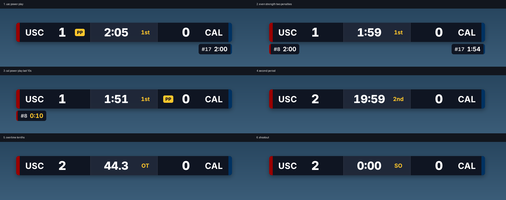

# USC hockey score bug for ScoreSight

A broadcast score bug for ice hockey, driven live by [ScoreSight](https://github.com/royshil/scoresight) reading the rink scoreboard. It is a custom overlay for ScoreSight's browser overlays (ScoreSight **0.3.0 or later**), shown in Wirecast, OBS, vMix or anything else that can display a web page.



It shows both scores, the clock, the period (1st, 2nd, 3rd, OT, SO), up to two running penalties per team with jersey numbers, and a **PP** badge for the team on the power play. A penalty's time turns gold in its last 10 seconds. The bug never changes size.

## Install (no technical knowledge needed)

1. Install ScoreSight 0.3.0 or later from the [ScoreSight releases page](https://github.com/royshil/scoresight/releases).
2. Download **usc-scorebug.html** from this project's [latest release](https://github.com/jdralla/scoresight/releases).
3. In ScoreSight, open the **Outputs** tab and select **HTTP server**. Under **Browser overlays**, click the folder button next to the **Overlay** list. A folder opens.
4. Drag **usc-scorebug.html** into that folder. (On a Mac it is `~/Library/Application Support/scoresight/overlays`.)
5. In Wirecast, add a **Web Page** source, size 1920 x 1080, with this address (change the team names and colors as needed):

   ```
   http://localhost:18099/overlay/custom/usc-scorebug.html?home=USC&away=CAL&homeColor=990000&awayColor=003262
   ```

To update, download the new file and replace the old one in the same folder.

## Boxes to draw in ScoreSight

Name the boxes exactly like this. Boxes you leave out are simply not shown.

| Box name | What it reads | Type |
|---|---|---|
| `Home Score`, `Away Score` | Goals | Number |
| `Time` (or `Clock`) | Game clock | Time |
| `Period` | Period digit | Number |
| `Home Pen 1`, `Home Pen 2`, `Away Pen 1`, `Away Pen 2` | Penalty timers | **Time** |
| `Home Pen 1 Player`, ... `Away Pen 2 Player` (optional) | Jersey number beside each penalty timer | Number |

## Options

Add these to the address after `?`, separated by `&`.

| Option | Example | Meaning |
|---|---|---|
| `home`, `away` | `home=USC&away=UCLA` | Team names |
| `homeColor`, `awayColor` | `homeColor=990000` | Team colors, hex without `#` |
| `scale` | `scale=0.9` | Shrink or grow the bug |
| `bg` | `bg=00ff00` | Solid background, for chroma keying |
| `debug` | `debug=1` | Show the raw readings and the connection state |
| `server` | `server=http://192.168.1.20:18099` | Only when the file is not served by ScoreSight |

## Misread protection

Scoreboard OCR misreads now and then, so the bug waits before it believes a change. The delays are at the top of the script in `usc-scorebug.html` (`CONFIG`).

- A score goes up after the new value has held for 0.6 s, and down after 1.6 s.
- The clock ignores a jump of more than 3 s until a second reading confirms it, and keeps the last good value during dropouts.
- A penalty appears after 0.4 s of consistent readings and disappears after 1.2 s of blank readings.

## Status

Tested automatically (below) with ScoreSight 0.3.0 on Linux in a Chromium browser. **Not yet tested** in Wirecast, on a Mac, or against a real scoreboard. See the [issues](https://github.com/jdralla/scoresight/issues?q=is%3Aissue+label%3Ascorebug).

## Development

Everything is in one file, `usc-scorebug.html`: plain HTML, CSS and JavaScript, no build step. It loads ScoreSight's `/overlay/client.js` and reads `ScoreSight.fields`; see ScoreSight's `docs/overlays.md` for that contract.

### Automated test

`tools/test_overlay.py` renders a 42-second synthetic hockey scoreboard video (`docs/test-board.png` is one frame), runs the real ScoreSight on it without a screen, opens the overlay in a headless browser, and checks what it shows: power plays, even strength, the gold last 10 seconds, jersey numbers, all four period labels, tenths of a second, a goal, a quarter-second misread that must not appear, and a constant width.

```
git clone --branch 0.3.0 https://github.com/royshil/scoresight
cd scoresight && pip install -r requirements.txt playwright && python scripts/fetch_models.py && cd ..
playwright install chromium
QT_QPA_PLATFORM=offscreen SCORESIGHT_SRC=scoresight python tools/test_overlay.py /tmp/scorebug-test
```

Screenshots land in `<workdir>/run/shots`, every sample in `<workdir>/run/log.json`.

### Releasing

Change the version in the header comment and `<title>` of `usc-scorebug.html`, add a line to `CHANGELOG.md`, and push to the `usc-scorebug` branch. GitHub Actions publishes a release named `scorebug-v<version>` with the file attached.

## License

MIT, like ScoreSight.
